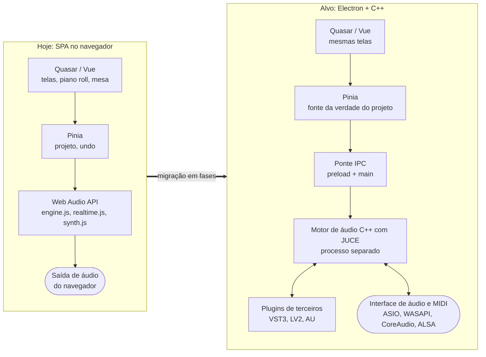
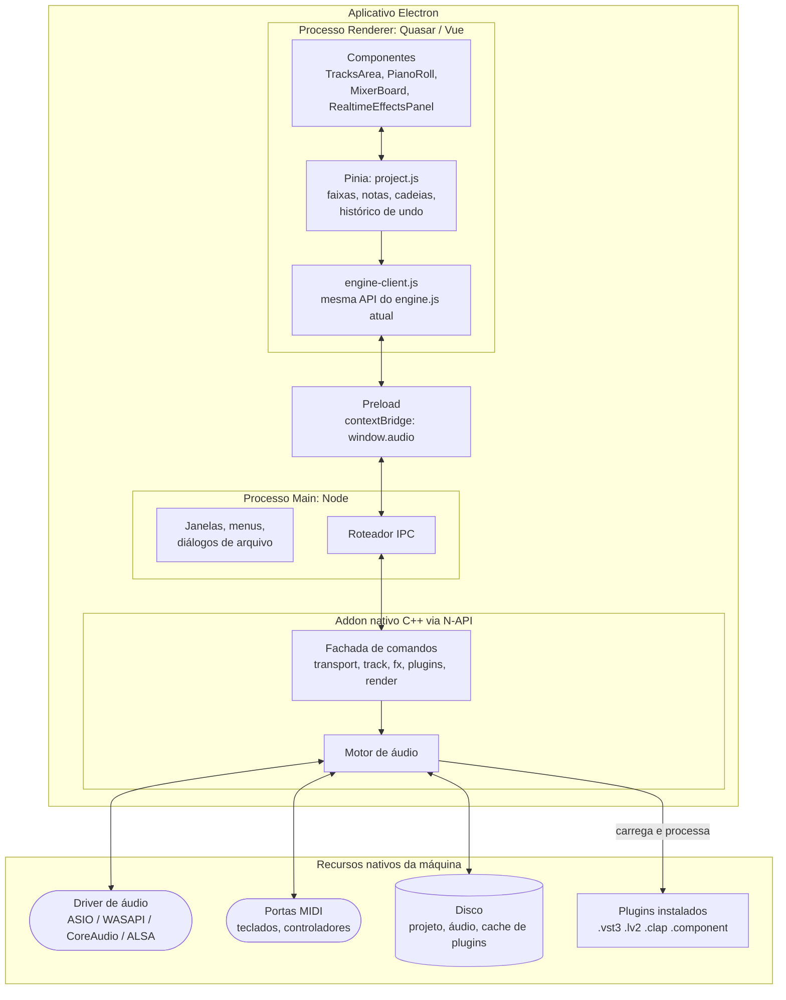
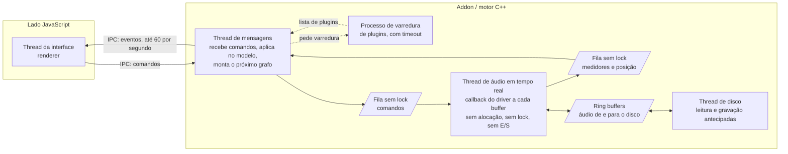
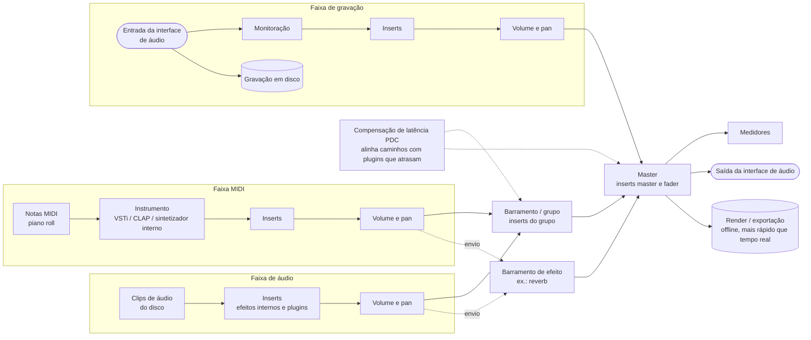
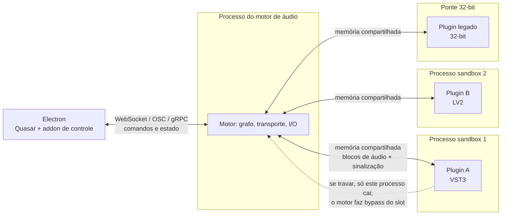
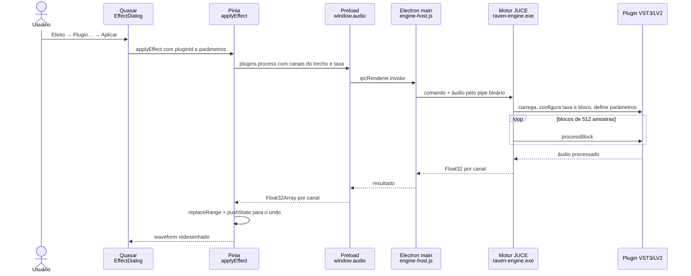
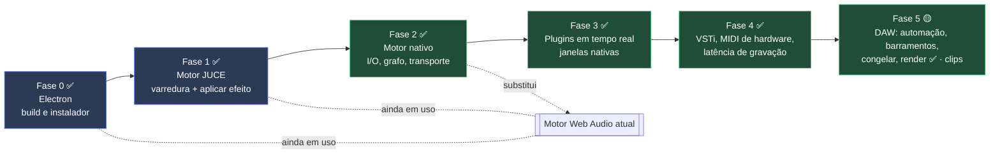
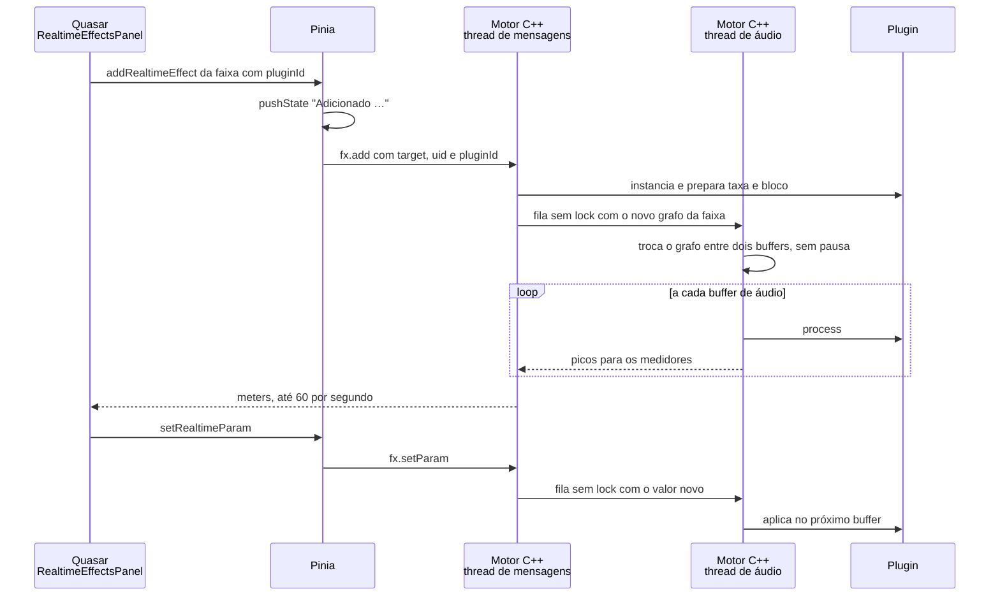
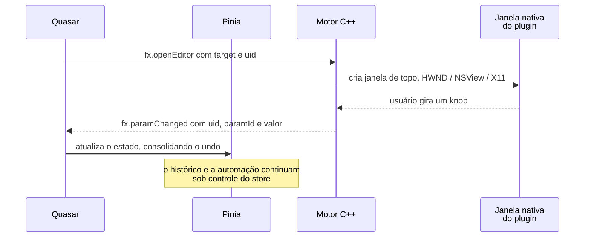
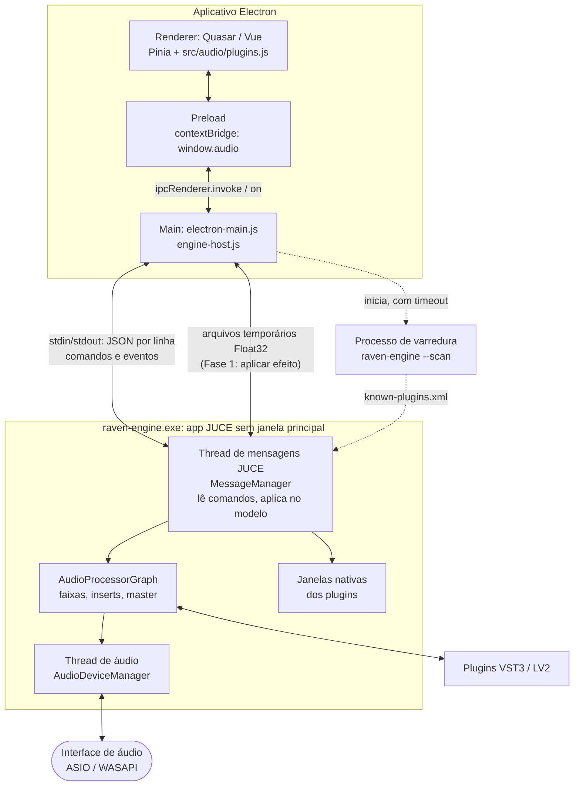

# Plugins de áudio (VST, LV2, LADSPA, CLAP) e o caminho para uma DAW nativa

Este documento registra a análise sobre integrar plugins de terceiros e o plano
para transformar o Raven Audio Editor, hoje uma SPA Quasar, num aplicativo
**Electron + C++** com acesso nativo à máquina e, mais adiante, numa DAW.

- Situação atual: app Quasar que roda no navegador e em modo Electron
  (`npm run dev:electron`), com motor de áudio em Web Audio API.
- Objetivo: app desktop (Electron) com motor de áudio nativo em C++, hospedagem
  de plugins de terceiros, baixa latência e acesso direto a dispositivos de áudio e MIDI.
- **Decisão tomada: o motor nativo será feito com JUCE**, rodando como um
  executável separado controlado pelo Electron. Ver a [seção 4](#4-decisão-motor-com-juce).
- **Licença: o Raven é código aberto sob AGPLv3**, usando o JUCE também sob
  AGPLv3. Ver a [seção 7](#7-licenças).

> Os diagramas usam **Mermaid**. Eles aparecem desenhados no GitHub e no GitLab,
> e no VS Code com a extensão *Markdown Preview Mermaid Support*.

### Visão geral: de onde saímos e aonde queremos chegar



---

## 1. Por que plugins não funcionam no navegador

VST2, VST3, LV2, LADSPA e CLAP são **bibliotecas nativas compiladas**:

| Formato | Arquivo | Observação |
|---|---|---|
| VST2 | `.dll` (Win), `.vst` (macOS), `.so` (Linux) | SDK descontinuado, ver seção 7 |
| VST3 | pacote `.vst3` | SDK gratuito da Steinberg |
| LV2 | pasta `.lv2` (`.so`/`.dll` + metadados `.ttl`) | Padrão aberto |
| LADSPA | `.so`/`.dll` | Antecessor do LV2, sem interface gráfica própria. **Não existe "LV1"**: o formato anterior ao LV2 é o LADSPA |
| CLAP | `.clap` | Padrão aberto e moderno, com adoção crescente |
| AU | `.component` | Só macOS |

O programa que hospeda o plugin carrega a biblioteca **no próprio processo** e
chama as funções de processamento no **thread de áudio em tempo real**. O
navegador não permite carregar código nativo. Mesmo o `AudioWorklet` só executa
JavaScript ou WebAssembly. Por isso, numa SPA, a integração com esses
plugins é impossível.

O Audacity faz a hospedagem em código nativo, e o clone em `refs/audacity`
mostra onde:

| Formato | Biblioteca de hospedagem | Interface/efeito |
|---|---|---|
| VST2 | `libraries/lib-vst` | `src/effects/VST` |
| VST3 | `libraries/lib-vst3` | `src/effects/VST3` |
| LV2 | `libraries/lib-lv2` | `src/effects/lv2` |
| LADSPA | `libraries/lib-ladspa` | `src/effects/ladspa` |
| Audio Unit | `libraries/lib-audio-unit` | `src/effects/audiounits` |

Esses módulos são boas referências de implementação (descoberta de plugins,
carregamento, mapeamento de parâmetros, presets, tela genérica).

---

## 2. Opções de arquitetura

> **Atualização:** com a escolha do JUCE, o caminho adotado é a **Opção B**
> (motor em processo separado). A Opção A continua descrita aqui porque o fluxo
> de sinal, as threads e o contrato de comandos valem igualmente para a Opção B.
> O motivo da troca está na [seção 4.2](#42-por-que-processo-separado-e-não-addon-n-api).

### Opção A: Electron + motor de áudio nativo em C++ como addon N-API

#### Diagrama de componentes



#### Threads dentro do motor C++

O ponto mais importante da arquitetura: o **thread de áudio** nunca espera
ninguém. A comunicação com ele é só por filas sem lock.



#### Fluxo de sinal da DAW (grafo de áudio)

É a mesma topologia que o `engine.js` já monta em Web Audio (faixa → efeitos da
faixa → pan/volume → master), acrescida de barramentos, envios e instrumentos virtuais.



- O áudio **não passa pela interface**. O Quasar envia comandos (tocar, mover
  fader, adicionar efeito) e recebe estado (posição, medidores, latência).
- Ir e voltar entre Web Audio e o código nativo por IPC adiciona latência e
  causa cortes. Por isso **o motor inteiro precisa ir para o lado nativo**.
- Bibliotecas candidatas:
  - **JUCE**: I/O de áudio e MIDI multiplataforma, hospedagem de VST3, AU e LV2
    (desde o JUCE 7), grafo de processamento (`AudioProcessorGraph`). Licença
    comercial ou AGPLv3.
  - **Tracktion Engine**: motor de DAW completo construído sobre o JUCE
    (edições, clips, automação, plugins, render).
  - **Carla**: hospeda LADSPA, DSSI, LV2, VST2, VST3, CLAP e SF2/SFZ, e pode rodar
    sem interface própria, como biblioteca ou processo. Licença GPLv2+.
  - Alternativa mais "mão na massa": **RtAudio/PortAudio** + **VST3 SDK** + **lilv**
    (LV2) + **CLAP SDK**, com grafo próprio.

### Opção B: processo nativo separado, controlado pela interface (adotada, com JUCE)

- Um executável à parte (por exemplo Carla em modo sem interface, ou um app
  JUCE próprio) faz o áudio e os plugins. O Quasar conversa com ele por
  WebSocket, OSC ou gRPC.
- Vantagens:
  - **isolamento**: um plugin que trava não derruba a interface;
  - permite **sandbox de plugins** (um processo por plugin, como o Bitwig faz);
  - funciona até com a interface no navegador.
- Desvantagens: mais coordenação entre processos e mais um executável para distribuir.
- Dá para combinar com a Opção A: o addon só inicia e controla o processo de áudio.



### Opção C: só aplicar o efeito, sem tempo real (fase intermediária)

- No Electron, o motor nativo recebe um trecho de áudio (`Float32Array`),
  passa pelo plugin e devolve o resultado, como o "Efeito → Aplicar" do Audacity.
- Mantém o motor Web Audio atual. Não há prévia ao vivo nem plugin na mesa de
  som durante a reprodução.
- É o menor passo para validar a hospedagem de plugins sem reescrever o motor.
- O preload **não** fala direto com código nativo: no Electron 20+ ele roda em
  sandbox e não carrega módulos `.node`. O caminho é sempre
  preload → `ipcRenderer.invoke` → processo main → motor.



### Opção D: continuar 100% web (Web Audio Modules)

- **WAM 2.0** é o padrão de plugins para o navegador, com plugins em
  WebAssembly (gerados com iPlug2, Faust, ports do JUCE).
- Não carrega os plugins nativos já instalados na máquina. Só serve se a
  aplicação precisar continuar rodando no navegador.

---

## 3. Recomendação e roteiro

Para o objetivo declarado (app desktop, acesso nativo e uma DAW no futuro), o
caminho é um **motor nativo com JUCE em processo separado** (Opção B), chegando
nele em fases. A Fase 1 usa esse mesmo processo só para aplicar efeitos (Opção C).

| Fase | Entrega | Motor de áudio | Risco |
|---|---|---|---|
| 0 ✅ | Projeto em modo Electron (`@quasar/app-vite` v3), `npm run dev:electron` e `npm run build:electron` funcionando | Web Audio (atual) | Concluída |
| 1 ✅ | Executável JUCE (`raven-engine`) iniciado pelo Electron, que **lista plugins** VST3/LV2 instalados e **aplica efeito em trecho** (Opção C). Testada pela interface no modo dev e no app empacotado (seção 8) | Web Audio + motor JUCE só para aplicar efeito | Concluída |
| 2 ✅ | **Motor nativo** de reprodução e mixagem (I/O nativo, grafo, transporte). O Web Audio sai do app desktop (seção 4.6) | Nativo | Concluída |
| 3 ✅ | Plugins **em tempo real** nas cadeias de faixa e master, mais as janelas nativas dos plugins (seção 4.7) | Nativo | Concluída |
| 4 ✅ | Instrumentos virtuais (VSTi) nas faixas MIDI, entrada MIDI de hardware, gravação com compensação de latência (seção 4.8) | Nativo | Concluída |
| 5 🟡 | Recursos de DAW: automação, envios/barramentos, congelar faixa e render em segundo plano feitos (seção 4.9); falta **clips** (vários trechos por faixa) | Nativo | Em andamento |



Azul: fases que ainda usam o motor Web Audio. Verde: fases com motor nativo.

### 3.1 O que muda no código atual

| Hoje (SPA) | Depois (Electron + C++) |
|---|---|
| `src/audio/engine.js` (grafo Web Audio, `render` offline, agendador MIDI, gravação) | Vira um **cliente** do motor nativo: mesma API (`play`, `stop`, `updateMix`, `render`, `startCapture`), mas implementada com chamadas IPC. No navegador continua usando Web Audio (detecta `window.audio`) |
| `src/audio/realtime.js` (efeitos como nós Web Audio) | Efeitos internos migram para C++. O catálogo passa a vir do motor (internos + plugins encontrados na varredura) |
| `src/audio/synth.js` | Sai de cena ou vira o instrumento padrão no motor nativo. Faixas MIDI passam a aceitar VSTi |
| `src/audio/effects.js`, `dsp.js` | Podem ficar em JS no começo (efeitos destrutivos). Depois migram para C++ por desempenho |
| `src/stores/project.js` | **Continua sendo a fonte da verdade** do projeto (faixas, notas, cadeias, undo). Envia os comandos ao motor (ver `syncPlayback`, `addRealtimeEffect`) |
| Áudio em `Float32Array` na memória do renderer | O áudio passa a viver no motor, com paginação em disco para projetos longos (como o `.aup3`/SQLite do Audacity). O renderer recebe só resumos para desenhar o waveform (`summary.js` vira um serviço do motor) |
| `.ravenproj` (JSON + Float32) | Formato de projeto com referência a arquivos de áudio e **estado dos plugins** (chunk do VST3, estado do LV2) |

A separação que já existe ajuda nessa migração: as telas (`components/`)
não falam com o Web Audio diretamente, só com o store e com `engine`.

### 3.2 Contrato de IPC sugerido (rascunho)

> Este rascunho é o alvo das **Fases 2 e 3** (motor em tempo real). Os comandos
> que já existem, da Fase 1, têm outros nomes (`plugins.list`, `fx.create`,
> `fx.setParam`, `fx.process` etc.) e estão na [seção 4.5](#45-ligação-com-o-electron-como-está-implementado).

Mensagens da interface para o motor (comandos):

```
transport.play { from, to, loop }      transport.stop
track.setGain { id, db }               track.setPan { id, pan }
fx.add { target, pluginId }            fx.remove { target, uid }
fx.setParam { target, uid, paramId, value }
fx.openEditor { target, uid }          // abre a janela nativa do plugin
plugins.scan { paths }                 render.offline { range, tracks } -> arquivo
```

Mensagens do motor para a interface (eventos, 30 a 60 por segundo no máximo):

```
transport.position { t }               meters { trackId: [l, r], master: [l, r] }
plugins.scanProgress / plugins.list    fx.paramChanged { ... }   // mexeu na janela do plugin
engine.xrun / engine.latency
```

Exemplo: adicionar um plugin à faixa e mexer em parâmetros enquanto toca.



Exemplo: abrir a janela nativa do plugin e manter a interface sincronizada.



Regras importantes:
- **Nunca** bloquear o thread de áudio esperando a interface. A comunicação
  com o thread de áudio usa filas sem lock.
- Medidores e posição são enviados com taxa limitada, nunca a cada buffer.

---

## 4. Decisão: motor com JUCE

O motor nativo será escrito com o **JUCE** (https://juce.com). PortAudio e
RtAudio foram descartados: eles só abrem o dispositivo de áudio, e todo o resto
(hospedar plugins, MIDI, ler arquivos, grafo de processamento) teria que ser
escrito à mão ou juntado de várias bibliotecas.

### 4.1 O que o JUCE resolve e o que não resolve

| Necessidade | Módulo / classe do JUCE | Observação |
|---|---|---|
| Driver de áudio (ASIO, WASAPI, CoreAudio, ALSA, JACK) | `juce_audio_devices`: `AudioDeviceManager` | O JUCE 9 já traz o ASIO SDK 2.3; ligado por padrão (`RAVEN_ASIO=ON`) |
| Portas MIDI de hardware | `juce_audio_devices`: `MidiInput`, `MidiOutput` | |
| Varredura e carga de plugins | `juce_audio_processors`: `AudioPluginFormatManager`, `KnownPluginList`, `PluginDirectoryScanner` | VST3, AU (macOS), LV2 e LADSPA (Linux). VST2 só com o SDK antigo, ver seção 7 |
| Varredura isolada (plugin que trava não derruba o motor) | `PluginDirectoryScanner` com um processo filho de varredura | Mesmo padrão do `AudioPluginHost` de exemplo do JUCE |
| Grafo de processamento (faixas, inserts, envios, master) | `AudioProcessorGraph` | Substitui o grafo que o `engine.js` monta hoje em Web Audio |
| Posição, BPM e compasso para os plugins | `AudioPlayHead` | Necessário para plugins sincronizados (delays, arpejadores) |
| Ler e gravar WAV, AIFF, FLAC, OGG, MP3 (leitura) | `juce_audio_formats`: `AudioFormatManager` | Exportar MP3 e formatos de vídeo exige FFmpeg ou LAME à parte |
| Reamostragem de qualidade | `juce_dsp`, `LagrangeInterpolator`, `WindowedSincInterpolator` | Melhor que a reamostragem linear atual |
| Efeitos internos (filtros, compressor, reverb) | `juce_dsp` | Para portar `realtime.js` para C++ |
| Janelas nativas dos plugins | `AudioProcessorEditor` em `DocumentWindow` | Abertas pelo motor, fora do Electron |
| **Plugins CLAP** | **Não suportado** pelo JUCE como host | Se for necessário, usar o CLAP SDK direto ao lado do JUCE (fase futura) |
| Projeto em SQLite (estilo `.aup3`) | Não tem | Usar SQLite à parte, se for seguir esse formato |

**Licença:** o JUCE é usado sob **AGPLv3**, e o Raven é **código aberto sob
AGPLv3** (decisão registrada na [seção 7](#7-licenças)). Não é preciso licença
comercial do JUCE.

### 4.2 Por que processo separado e não addon N-API

A pesquisa inicial sugeria compilar o motor como um addon `.node`
(node-addon-api) carregado pelo Electron. Com o JUCE isso não é uma boa ideia:

1. **O JUCE precisa do próprio laço de mensagens** (`MessageManager`). As janelas
   dos plugins, a varredura e vários plugins dependem dele. Dentro do Electron, o
   thread principal já é do Chromium/Node. No macOS o laço de mensagens precisa
   estar no thread principal do processo, então lá é **impossível**. No Windows
   funciona com gambiarras.
2. **Isolamento de falhas:** um plugin com defeito derruba o processo onde está.
   Num processo separado, o Electron mostra um aviso e reinicia o motor; a
   interface e o projeto aberto continuam vivos.
3. **Compilação mais simples:** o motor é um projeto CMake comum do JUCE. Não
   precisa compilar contra os cabeçalhos do Node/Electron, nem usar `cmake-js`
   ou `@electron/rebuild`, e atualizar o Electron não exige recompilar o motor.
4. **Prioridade de thread:** o motor pode pedir prioridade de tempo real para o
   thread de áudio sem disputar com o Chromium.

O custo é a comunicação entre processos, que é aceitável porque **o áudio não
precisa ir para a interface** durante a reprodução: só comandos, posição e
medidores. A interface só recebe áudio para desenhar o waveform, e mesmo isso
pode virar resumos (min/max/rms) calculados pelo motor.

### 4.3 Arquitetura com JUCE



- **Canal de controle:** stdin/stdout do processo, uma mensagem JSON por linha
  (formato em `engine/src/Protocol.h`). Simples de depurar e de testar sem interface.
- **Canal de dados (Fase 1):** o trecho de áudio vai e volta por **arquivos
  temporários** Float32 planares (um canal inteiro depois do outro), e o JSON só
  leva os caminhos. Para aplicar um efeito offline isso é rápido e fácil de
  depurar. Mandar áudio dentro de JSON seria lento demais.
- **Canal de dados (Fase 2 em diante):** com reprodução em tempo real e resumos
  de waveform, trocar os arquivos por um pipe nomeado (`\\.\pipe\raven-engine-<pid>`
  no Windows, socket Unix no macOS/Linux) com mensagens binárias.
- **`SharedArrayBuffer` não funciona entre processos.** A pesquisa inicial
  sugeria usá-lo entre o C++ e a interface, mas ele só compartilha memória dentro
  de um mesmo processo. Entre o motor e o Electron, o equivalente seria memória
  compartilhada do sistema operacional, que só vale a pena se o pipe se mostrar lento.
- **O motor é um "GUI app" do JUCE sem janela principal** (`juce_add_gui_app` com
  um `JUCEApplication` que não cria janela), e não um "console app". O console
  app do JUCE não roda o laço de mensagens, e sem ele as janelas dos plugins não
  abrem.

### 4.4 Estrutura de pastas (implementada na Fase 1)

```
REA/
├─ LICENSE                         ← AGPLv3
├─ engine/                         ← motor JUCE (C++)
│  ├─ CMakeLists.txt               ← JUCE_PLUGINHOST_VST3/LV2/AU, ASIO opcional
│  ├─ third_party/JUCE/            ← submódulo git, fixado na tag 9.0.5
│  ├─ src/
│  │  ├─ Main.cpp                  ← JUCEApplication sem janela; modo normal e --scan
│  │  ├─ Protocol.h/.cpp           ← JSON por linha no stdin/stdout
│  │  ├─ Scanner.h/.cpp            ← varredura com PluginDirectoryScanner
│  │  └─ PluginHost.h/.cpp         ← instâncias, janelas nativas, processamento offline
│  ├─ build/                       ← gerado pelo CMake (ignorado pelo git)
│  └─ bin/                         ← raven-engine(.exe) copiado após compilar (ignorado)
├─ src-electron/
│  ├─ electron-main.js             ← registra os ipcMain.handle('engine:*')
│  ├─ electron-preload.js          ← expõe window.audio
│  └─ engine-host.js               ← inicia/reinicia o motor, varredura, áudio temporário
└─ src/
   ├─ audio/plugins.js             ← cliente de window.audio no renderer
   └─ components/PluginEffectDialog.vue ← Efeito → Plugin (VST3 / LV2)…
```

O motor usa CMake em vez do Projucer: é o caminho recomendado pelo JUCE hoje e
permite compilar com o mesmo comando em CI e na máquina de desenvolvimento.

### 4.5 Ligação com o Electron (como está implementado)

- **`src-electron/engine-host.js`**, no processo main:
  - inicia o motor com `child_process.spawn` **no primeiro pedido** (quem não usa
    plugins não paga nada);
  - casa respostas pelo `id`, repassa eventos ao renderer com
    `webContents.send('engine:event', ...)`;
  - se o motor cair, rejeita os pedidos pendentes, avisa a interface
    (`engine.exit`) e o reinicia (até 3 vezes seguidas);
  - a varredura roda em outro processo (`raven-engine --scan`). Se ele cair ou
    passar 60 s sem progresso, é encerrado e reiniciado: o "dead man's pedal" do
    JUCE coloca o plugin culpado na lista negra e a varredura continua (até 10 tentativas);
  - encerra o motor no `before-quit`, fechando o stdin.
- **Caminhos** vão por variáveis de ambiente, não pela linha de comando:
  `RAVEN_PLUGIN_CACHE` (lista de plugins, em `<userData>/plugins/known-plugins.xml`)
  e `RAVEN_SCAN_PEDAL`. `RAVEN_ENGINE_PATH` força outro executável do motor, útil
  para depurar.
- **`src-electron/electron-preload.js`** expõe `window.audio` com `contextBridge`:
  `engineStatus()`, `request(cmd, args)`, `scanPlugins({ full })`,
  `process(instanceId, channels, sampleRate)` e `onEvent(callback)`. O main só aceita
  os comandos de uma lista fechada. Nada de `nodeIntegration`.
- **Comandos do motor:** `ping`, `plugins.list`, `fx.create`, `fx.setParam`,
  `fx.openEditor`, `fx.closeEditor`, `fx.process`, `fx.destroy`. Eventos:
  `ready`, `scan.progress`, `scan.failed`, `scan.done`, `scan.crashed`,
  `fx.paramChanged` (mexeram na janela do plugin), `fx.editorClosed`, `engine.exit`.
- **Empacotamento:** um executável não roda de dentro do `app.asar`. O
  `quasar.config.js` inclui `engine/bin/raven-engine.exe` como `extraResource`
  quando ele existe, e em produção o motor é procurado em `process.resourcesPath`.
  No modo dev, o caminho é `engine/bin/` direto.
- **Processamento offline:** blocos de 512 amostras, `setNonRealtime(true)`, e
  a latência informada pelo plugin é compensada (o trecho processado fica
  alinhado com o original). Plugin só mono numa faixa estéreo processa um canal
  por vez.
- **Pré-rolo de 0,5 s:** antes do trecho, o motor passa meio segundo de silêncio
  pelo plugin e descarta a saída. Muitos plugins suavizam mudanças de parâmetro
  (o kHs Gain leva ~50 ms para chegar ao valor novo); sem o pré-rolo, o começo
  de cada trecho processado saía com o valor antigo.
- **Parâmetros discretos** (Bypass, modos, presets) viram listas no diálogo. Como
  plugins VST3 não preenchem `getAllValueStrings()`, o motor monta os textos com
  o `getText()` de cada passo.

### 4.6 Fase 2: motor de áudio nativo (como está implementado)

No app desktop, tocar, mixar, aplicar efeitos em tempo real, sintetizar MIDI,
renderizar e gravar passaram para o `raven-engine`. No navegador (e no desktop,
se o motor não existir ou não abrir o dispositivo) continua o motor Web Audio.
As telas não mudaram: `src/audio/engine.js` exporta `engine`, que encaminha as
chamadas para o motor nativo (`src/audio/engine-native.js`) assim que ele responde.

**No motor (C++):**

| Arquivo | O que faz |
|---|---|
| `engine/src/AudioEngine.cpp` | Dispositivo de áudio (`AudioDeviceManager`), transporte, prévia, nota avulsa, medidores (30/s), render offline, gravação e escolha de dispositivo (salva em `<userData>/audio-settings.xml`) |
| `engine/src/MixGraph.cpp` | O mesmo grafo do `engine.js`: clipe ou sintetizador → efeitos da faixa → ganho/pan → Σ → efeitos do master → fader. Imutável: a cada mudança o motor monta outro e troca sem parar o som |
| `engine/src/RealtimeEffects.cpp` | Os 8 efeitos em tempo real de `realtime.js` (Ganho, Graves e Agudos, Filtro, Eco, Reverb, Compressor, Limitador, Distorção), com o crossfade de liga/desliga |
| `engine/src/Synth.cpp` | O sintetizador de `synth.js`: 16 famílias General MIDI e bateria |
| `engine/src/Dsp.h` | Biquad com as fórmulas da especificação Web Audio, osciladores sem aliasing (PolyBLEP) e suavização de parâmetros |

**Decisões:**

- **Taxa do projeto ≠ taxa do dispositivo:** o projeto é mixado na taxa dele e
  convertido para a do dispositivo (`ResamplingAudioSource`). O modo compartilhado
  do Windows só toca na taxa do mixer do sistema (48 kHz aqui).
- **Mudar o mix tocando não reinicia mais a reprodução** (no Web Audio, mudar a
  estrutura de uma cadeia reiniciava). Notas soando, caudas de reverb/eco e ganhos
  suavizados ficam em objetos que sobrevivem à troca de grafo (`TrackState`,
  `RealtimeEffect`).
- **Thread de áudio sem espera:** o grafo é trocado com try-lock e os objetos
  antigos são liberados no thread de mensagens.
- **Áudio das faixas:** continua morando na interface. Cada `Float32Array` vira
  um "clipe" enviado uma vez ao motor (`clips.load`) e reaproveitado; clipes que
  saem do projeto são liberados (`clips.release`) e reenviados se o desfazer os
  trouxer de volta. As notas MIDI só vão quando a faixa muda (`notesKey`).
- **Gravação:** a entrada abre na primeira gravação (~2 s no WASAPI, porque o
  dispositivo inteiro reabre) e fica aberta até o app fechar: as gravações
  seguintes começam na hora e parar é instantâneo. O indicador de microfone do
  Windows fica aceso depois da primeira gravação. A interface lê o áudio gravado
  a cada 100 ms, já convertido para a taxa do projeto.
- **Entrada padrão:** é a entrada padrão do Windows (a mesma que o navegador
  usaria). Nesta máquina é o "CABLE Output (VB-Audio Virtual Cable)", que fica em
  silêncio; para gravar do microfone, escolha-o em **Transporte → Dispositivos de áudio…**.
- **ASIO** ligado por padrão (`RAVEN_ASIO=ON`), com o ASIO SDK que vem no JUCE (GPLv3).

**Comandos novos do protocolo:** `audio.status`, `audio.devices`,
`audio.setDevice`, `project.sync`, `project.setRate`, `clips.load`,
`clips.release`, `transport.play`, `transport.stop`, `preview.play`,
`preview.stop`, `synth.audition`, `render.offline`, `capture.start`,
`capture.read`, `capture.stop`. Eventos: `meters` (posição, picos do master,
das faixas e da entrada) e `transport.ended`.

**Paridade com o motor Web Audio** (mesmo projeto renderizado pelos dois motores
dentro do app, diferença de RMS):

| Caso | Diferença |
|---|---|
| Seco com ganho e pan, Ganho, Graves e Agudos, Filtros, Distorção | 0,00 dB |
| MIDI: piano, cordas, synth lead, bateria | 0,00 a 0,02 dB |
| Eco (com ruído) | −0,02 dB |
| Reverb, só sinal processado (com ruído) | −0,1 dB (a resposta ao impulso é aleatória nos dois motores) |
| Compressor / Limitador | +0,7 / +0,3 dB (detector um pouco diferente do Chromium) |

Diferenças conhecidas, todas herdadas do navegador ou intencionais:

- **Eco com tons puros:** o Chromium acrescenta 128 amostras (2,9 ms) no laço de
  realimentação; o motor nativo segue a fórmula exata do `EchoBase` do Audacity.
  Com sinais musicais a diferença não se ouve.
- **Limitador passa do teto:** o `DynamicsCompressorNode` aplica um ganho de
  compensação automático, e o Limitador (que é um compressor) herda isso: com teto
  de −12 dB a saída fica em torno de −5 dB. O motor nativo reproduz o mesmo
  comportamento para o som não mudar entre navegador e desktop. **A corrigir nos
  dois motores.**
- **Osciladores:** quadrada e dente de serra são normalizadas pelo pico com o
  overshoot de Gibbs (fator 0,848), como as tabelas do navegador.

**O que fica para depois:**

- O áudio ainda mora na memória da interface (sem paginação em disco).

### 4.7 Fase 3: plugins nas cadeias em tempo real (como está implementado)

Um slot de plugin VST3/LV2 entra na mesma cadeia dos efeitos embutidos, da faixa
ou do master: **Efeitos em tempo real → Adicionar efeito → Plugin (VST3 / LV2)…**.
O plugin processa ao tocar e ao exportar, sem alterar o áudio da faixa, e pode
ser ligado/desligado, reordenado e removido como qualquer efeito.

**No projeto**, um slot de plugin é
`{ uid, type: 'plugin', enabled, plugin: { id, name, vendor, format }, state, stateVersion }`.
`state` é o estado do plugin (`getStateInformation`) em base64 (`null` = de
fábrica) e vai para o arquivo `.ravenproj`. No navegador, o slot passa o som sem
efeito (o motor Web Audio ignora `type: 'plugin'`).

**No motor:** `engine/src/PluginEffect.cpp` é um `RealtimeEffect` que embrulha a
instância do plugin.

- O thread de áudio nunca espera: usa *try-lock* no lock do plugin e, se ele
  estiver ocupado (trocando de estado), o som passa sem efeito naquele bloco.
- Plugin só mono numa cadeia estéreo recebe (L + R) / 2 e devolve nos dois canais.
- **Estado e histórico:** mexer no plugin (janela nativa ou parâmetros genéricos)
  dispara `chain.pluginState` depois de 400 ms sem mudanças; a interface grava o
  estado no efeito com "Plugin ajustado: <nome>" (ajustes seguidos viram um passo
  só). Desfazer/refazer manda o estado daquele passo, e o motor o aplica com
  `setStateInformation`. As notificações geradas pelo próprio
  `setStateInformation` não viram ajustes novos (o motor compara com o estado
  que acabou de aplicar).
- O estado só viaja quando muda (`stateVersion`, como as notas MIDI), porque pode
  ter centenas de KB.
- **Render offline:** instância nova do plugin, com o estado da instância ao vivo
  (pega ajustes feitos há menos de 400 ms).
- **Compensação de latência (PDC):** cada faixa é atrasada até a faixa mais lenta
  (até 1 s), a reprodução continua depois do fim pelo tempo da latência total, a
  posição mostrada desconta essa latência e o render offline descarta o começo.
  Se um plugin mudar a latência, o motor remonta o grafo.
- **Plugin ausente** (outra máquina, desinstalado): o motor avisa
  (`chain.pluginError`, notificação na interface), o slot passa o som e o estado
  fica guardado no projeto.
- **Janela nativa:** botão "Interface" no cartão do slot. A janela fecha sozinha
  se o slot for removido.

**Comandos novos:** `project.pluginInfo`, `project.setPluginParam`,
`project.openPluginEditor`, `project.closePluginEditor`. Eventos:
`chain.pluginState`, `chain.paramChanged`, `chain.editorClosed`, `chain.pluginError`.

**Na interface:** `PluginPickerDialog.vue` (escolher o plugin),
`PluginSlotBody.vue` (corpo do cartão: janela, latência, parâmetros) e
`PluginParamList.vue` (controles genéricos, também usados em Efeito → Plugin…).
Com o transporte parado o motor também recebe o projeto (`syncEngine`), para os
plugins ficarem carregados e a janela abrir sem precisar tocar.

**Testado** (18/11/2026):

| Teste | Resultado |
|---|---|
| kHs Gain na cadeia, Gain a 20% | −18,00 dB no render offline, −18,04 dB pela interface |
| Desfazer / refazer o ajuste | +0,00 dB → −18,05 dB, sem ajustes fantasmas no histórico |
| Desligar o plugin tocando | nível sobe +18 dB na hora, a posição segue contínua |
| PDC: mesmo ruído em duas faixas, uma com MFreeformPhase (8192 amostras) | soma +6,02 dB (alinhadas; desalinhadas dariam ~+3 dB) |
| Projeto salvo e reaberto | plugin e estado idênticos |
| Plugin ausente | aviso e som passando sem efeito |

### 4.8 Fase 4: instrumentos virtuais, entrada MIDI e latência da gravação (como está implementado)

**Instrumentos virtuais (VSTi) nas faixas MIDI.** O seletor de instrumento da faixa
(cabeçalho e piano roll) ganhou **Plugin (VSTi)…**; o botão ao lado abre a janela
do instrumento. No projeto, a faixa MIDI tem `instrument` (`null` = sintetizador
embutido, ou um slot de plugin com estado, como os da Fase 3); o estado vai para o
`.ravenproj` e para o desfazer ("Instrumento ajustado: <nome>"). No navegador, a
faixa toca o programa General MIDI no sintetizador embutido.

- No motor, o `PluginEffect` tem modo instrumento: sem entradas, saída estéreo, as
  notas entram como eventos MIDI (note on no início, note off guardado até a hora
  certa, mesmo em outro bloco). A latência do instrumento entra na compensação (PDC).
- **O grafo agora roda também com o transporte parado**: clipes e notas do projeto
  não tocam, mas instrumentos, notas ao vivo e caudas de reverb/eco continuam. Ao
  parar, as notas soltam com o release (sem corte seco nem nota presa); ao começar
  a tocar, tudo é cortado e os efeitos zeram. (Na Fase 2, parar silenciava na hora,
  como o motor Web Audio.)
- **A nota avulsa do piano roll toca pela própria faixa** (instrumento e efeitos),
  e não mais por um sintetizador à parte.
- Render offline com instrumento: o motor processa silêncio por 1 s antes, porque
  instrumentos carregam amostras em segundo plano (o FluidSynth dos AVL Drumkits
  fica mudo sem isso).

**Entrada MIDI.** Escolha em **Transporte → Dispositivos de áudio… → MIDI** (lembrada
entre sessões). O que se toca soa na **faixa MIDI selecionada**, pelo instrumento
dela. Com uma faixa MIDI selecionada (e nenhuma de áudio), **Gravar (R)** toca o
projeto a partir do cursor e grava as notas; ao parar, viram notas da faixa
("Gravado MIDI: N notas").

- O driver MIDI enfileira cada mensagem com o horário de chegada; o thread de áudio
  a posiciona dentro do bloco pelo atraso (atraso constante de um bloco, espaçamento
  preservado). O `MidiMessageCollector` do JUCE foi descartado porque perdia
  mensagens que chegavam entre a leitura do relógio e a entrada na fila.
- O tempo de cada nota gravada é a posição do transporte menos a latência de saída
  e a dos plugins: o momento em que o músico ouviu o que acompanhava.
- `midi.simulate` injeta mensagens no mesmo ponto do driver (testes; esta máquina
  não tem teclado MIDI).

**Compensação de latência na gravação de áudio.** Ao começar a gravar, o motor
informa a latência de ida e volta do driver (entrada + saída); ao parar, esse
trecho do começo do take é descartado, mais um ajuste manual em ms (em
Dispositivos de áudio → Gravação), para o take ficar alinhado com o que se ouvia.

**Robustez descoberta nesta fase:**

- **Plugins que imprimem no stdout** (o FluidSynth dos AVL Drumkits) corrompiam o
  canal JSON. O motor agora usa uma cópia privada do stdout para o protocolo e
  aponta o stdout do processo para o stderr (`Protocol.cpp`).
- **Destruir a interface de alguns plugins LV2 derruba o processo** (AVL Drumkits no
  Windows: exceção 0xC000041D dentro da janela). Para LV2, fechar só esconde a
  janela, e a instância que abriu a interface não é destruída até o motor encerrar
  (vazamento intencional, `keepEditorAlive` em `PluginWindow.h`). VST3 não muda.

**Comandos novos:** `midi.devices`, `midi.setInput`, `midi.startRecording`,
`midi.read`, `midi.stopRecording`, `midi.simulate`; `synth.audition` aceita
`trackId`; `capture.start` devolve `latency`; `project.sync` aceita
`midiTarget` e `instrument` nas faixas MIDI. O evento `meters` traz `midiIn`.

**Testado** (18/11/2026):

| Teste | Resultado |
|---|---|
| Black Pearl Drumkit (LV2) numa faixa MIDI: tocar, nota avulsa, render MIDI → áudio | pico 0,117 ao vivo, 0,466 no render |
| Parar com nota soando | release natural, silêncio em 0,9 s |
| Entrada MIDI na faixa selecionada / sem faixa selecionada | toca / não toca |
| Gravação MIDI (envios em 0,5 s e 1,2 s, 20 ms de latência) | notas em 0,49 e 1,19 s, duração 0,30 s; 5 de 5 rodadas com todos os eventos |
| Gravação MIDI com R pela interface + desfazer | 2 notas, intervalo e duração certos |
| Ajuste de 800 ms na compensação da gravação de áudio | take ~0,76 s mais curto |

### 4.9 Fase 5: recursos de DAW (como está implementado)

Quatro dos cinco itens. **Clips** (vários trechos independentes numa faixa, cada um
com posição e corte próprios) ficam para uma etapa à parte, porque mudam o modelo
de dados da faixa, a edição e o desenho.

**Envios e barramentos.** **Faixas → Novo barramento** cria uma faixa sem conteúdo
(`kind: 'bus'`) que recebe envios; ela tem efeitos, volume, pan, mudo e solo como
as outras. No painel de efeitos de uma faixa, a seção **Envios** liga a faixa a um
barramento (−6 dB por padrão, slider de −60 a +6 dB); o painel do barramento lista
quem envia para ele. O cabeçalho e o canvas do barramento mostram quantos envios
ele recebe.

- O envio é **pós-fader**: sai depois do volume, do pan e da automação da faixa. Faixa
  muda não envia.
- **Solo seguro**: barramentos não entram na conta do solo. Solar uma faixa cala as
  outras, mas não o reverb compartilhado que ela alimenta.
- **Compensação de latência**: as faixas alinham entre si, como antes; a saída direta
  das faixas espera, além disso, o barramento mais lento (segunda linha de atraso
  por faixa), para o som direto e o que volta do barramento chegarem juntos.
- No motor nativo o grafo roda em duas passadas por bloco: faixas (somando os
  envios nos buffers dos barramentos) e depois barramentos. No Web Audio, cada envio
  é um `GainNode` da saída da faixa para a entrada da cadeia do barramento.
- Os envios guardam o id do barramento; no `.ravenproj`, a posição dele na lista.
  Remover um barramento remove os envios para ele.

**Automação de volume e pan.** Ferramenta **Envelope** na barra (F3), com a escolha
**Vol / Pan** ao lado. Clicar no canvas da faixa cria um ponto (numa linha vazia, ou
em cima da linha, no valor que a linha tinha), arrastar move, duplo clique remove;
cada gesto vira um passo do desfazer ("Automação de volume alterada"). O menu ⋮ da
faixa tem "Remover automação de volume/pan".

- `track.automation = { gain: [{ t, v }], pan: [{ t, v }] }`, com `t` em segundos desde
  o início da faixa: mover a faixa leva a automação junto. Recortar, colar, aparar e
  gravar por cima deslocam os pontos com o áudio (`src/audio/automation.js`).
- **Volume em dB somados ao fader** (como o envelope do Audacity): o fader continua
  valendo. **Pan substitui** o pan da faixa enquanto houver pontos.
- Entre pontos, linha reta; antes do primeiro e depois do último, o valor deles.
- Motor nativo: alvo recalculado a cada 32 amostras e suavizado, no tempo do áudio
  que chega ao ganho (descontada a latência das cadeias). Web Audio: rampas lineares
  nos ganhos L/R, amostradas a cada 20 ms onde o volume muda. Diferença medida entre
  os dois num caso com rampa de volume, pan e barramento: −35 dB do pico.

**Congelar faixa.** Botão ❄ no cabeçalho, item no menu ⋮ e **Faixas → Congelar /
descongelar faixas selecionadas**. Renderiza o instrumento e os efeitos da faixa
(seco: sem volume, pan, automação e envios, com 2 s de cauda) e, a partir daí, o
motor toca esse áudio no lugar da cadeia, que é descarregada (alivia o processador
com VSTi e plugins pesados). Volume, pan, automação, envios, mudo e solo continuam
ao vivo.

- `track.frozen` guarda o áudio e referências do que foi renderizado (canais, notas,
  cadeia, instrumento, programa). **Editar qualquer um deles descongela sozinho**; o
  desfazer volta ao estado congelado. O painel de efeitos avisa que a faixa está
  congelada.
- O store entrega ao motor `engineTracks` (as congeladas como faixas de áudio sem
  cadeia); exportar, mixar e renderizar usam o mesmo caminho.
- O áudio congelado não vai para o `.ravenproj`: ao abrir, a faixa volta descongelada.

**Render em segundo plano.** Exportar não trava mais o motor: `render.offline` monta
o grafo e os plugins no thread de mensagens (os plugins pedem isso) e processa num
thread próprio. O motor continua atendendo a interface, então dá para tocar e
editar enquanto exporta. A exportação usa o projeto como estava ao começar.

- Eventos `render.progress { job, progress }` a cada 200 ms; `render.cancel { job }`
  interrompe e a resposta vira o erro "Render cancelado.". Os plugins do render são
  destruídos no thread de mensagens.
- Na interface, **Arquivo → Exportar** mostra um aviso com a porcentagem e
  **Cancelar**. No navegador, o `OfflineAudioContext` pausa em 20 pontos para
  informar o progresso; cancelar o deixa parado numa pausa (ele não tem como abortar).

**Comandos novos:** `render.cancel`; `render.offline` aceita `job` e emite
`render.progress`. Em `project.sync` e `render.offline`, as faixas aceitam
`kind: 'bus'`, `sends: [{ bus, level }]` e `automation`.

**Testado** (18/11/2026):

| Teste | Resultado |
|---|---|
| Envio de −6 dB para barramento, no motor e tocando pela interface | 1,500× o nível da faixa |
| Faixa muda / barramento mudo / solo na faixa | sem envio / só o direto / barramento continua |
| Duas faixas em 0 dB num barramento em −6 dB | 3,000× |
| Barramento com MFreeformPhase (8192 amostras de latência) | direto e barramento alinhados (1,500×) |
| Rampa de 0 a −40 dB entre 0,5 e 1,5 s, fader em −6 dB | −6,0 / −25,6 / −46,0 dB em 0,25 / 1,0 / 1,75 s |
| Pan automatizado para a esquerda | canal direito em silêncio |
| Envelope com dois cliques pela interface, desfazer | 2 pontos (0 dB e −35 dB), desfeito |
| Faixa MIDI congelada pelo botão ❄ | toca (pico 0,28); editar descongela; desfazer congela |
| Render de 1 min com dois reverbs de 10 s | motor respondeu ao ping em 0 ms durante os 27 s de render; 125 eventos de progresso |
| Cancelar render / exportação pela interface | erro "Render cancelado." em 29 ms / aviso "Exportação cancelada" |
| Projeto com barramento salvo e aberto | envio religado ao barramento novo |

### 4.10 Ambiente de desenvolvimento (Windows)

| Ferramenta | Para quê |
|---|---|
| Visual Studio 2022 Build Tools, carga "Desenvolvimento para desktop com C++" | Compilador MSVC e SDK do Windows |
| CMake 3.22 ou mais novo | Gera o projeto do motor |
| Git | Submódulo do JUCE |
| ASIO | Não precisa baixar: o JUCE 9 já traz o ASIO SDK 2.3 (opção GPLv3, ver seção 7). Ligado por padrão; para desligar, `cmake ... -DRAVEN_ASIO=OFF` |
| Ninja (opcional) | Compilação mais rápida |

Python e `node-gyp` **não** são necessários nesse modelo, porque o motor não é
um addon do Node.

---

## 5. Telas (GUI) dos plugins

- Cada plugin desenha a própria janela nativa (HWND no Windows, NSView no
  macOS, X11 no Linux). **Não é viável embutir essa janela dentro da página
  Electron.**
- Abordagens:
  1. Abrir a janela do plugin como **janela nativa separada**, criada pelo motor
     JUCE (`plugin->createEditorAndMakeActive()` dentro de uma `DocumentWindow`).
     É o padrão das DAWs. ✅ Implementado em `engine/src/PluginHost.cpp`
     (`PluginWindow`). Hoje a janela fica "sempre no topo". ⏳ Melhoria futura:
     o main passar o handle da janela do app (`getNativeWindowHandle()`) para o
     motor usar como janela dona, para ela minimizar junto com o app.
  2. **Tela genérica** gerada a partir dos parâmetros do plugin (como a opção
     "Generic UI" do Audacity e o nosso `RealtimeEffectsPanel.vue`). Útil para
     plugins sem tela e para automação. ✅ Duas versões: a do diálogo
     `PluginEffectDialog.vue` e, no motor, a `GenericAudioProcessorEditor` do
     JUCE para plugins sem interface própria.
- Os parâmetros alterados na janela nativa precisam voltar para o store da
  interface (evento `fx.paramChanged`), para manter undo e automação.
  ✅ Na Fase 1 o evento atualiza o diálogo; o undo vem do `store.applyEffect`.
- Só os parâmetros **automatizáveis** são listados. Sem esse filtro, plugins
  VST3 como o kHs Gain mostravam milhares de controladores MIDI internos.

---

## 6. Plataforma, desempenho e estabilidade

- **Arquitetura e SO:** o plugin precisa bater com o app (Windows x64, macOS
  arm64/x64 universal, Linux x64). Plugins 32-bit exigem uma ponte (processo
  separado).
- **Drivers no Windows:** ASIO para baixa latência (o SDK da Steinberg tem
  licença própria), WASAPI exclusivo como alternativa.
- **Thread de áudio:** sem alocação de memória, sem lock e sem E/S de disco no
  callback. O tamanho de buffer é configurável (64 a 1024 amostras).
- **Compensação de latência (PDC):** plugins informam latência; o motor
  alinha as faixas.
- **Plugins que travam:** com o motor em processo separado (seção 4.2), uma falha
  derruba só o motor, que o Electron reinicia. Além disso, marque o plugin como
  problemático para não carregá-lo de novo automaticamente (o Audacity tem um
  diálogo de plugins incompatíveis: `src/IncompatiblePluginsDialog.cpp`).
- **Varredura de plugins:** fazer em processo separado, com timeout e cache,
  porque alguns plugins travam ao carregar.
- **Assinatura e notarização:** instaladores no macOS precisam de notarização;
  no Windows, assinatura de código evita alertas do SmartScreen.

---

## 7. Licenças

### Decisão

- **O Raven Audio Editor é código aberto, sob AGPLv3.** Isso vale para o projeto
  inteiro: interface Quasar, `src-electron` e o motor `engine/`.
- **O JUCE é usado sob a licença AGPLv3**, sem licença comercial.

### O que isso exige

1. ✅ **Publicar o código-fonte** de toda versão distribuída (interface e motor), na
   mesma versão do instalador: repositório público
   https://github.com/GuiPassoskt/RavenAudioEditor. O build grava o commit
   (`import.meta.env.GIT_COMMIT`) e a tela "Sobre" aponta para o código exato
   daquela versão. **Gere instaladores só a partir de commits já enviados ao GitHub**,
   senão o link aponta para um commit que não existe lá.
2. ✅ **Arquivo `LICENSE`** com o texto da AGPLv3 na raiz do repositório e o campo
   `"license": "AGPL-3.0-or-later"` no `package.json` e no `src-electron/package.json`.
3. ✅ **Avisos de terceiros:** `npm run licenses` gera
   `src/legal/third-party-licenses.json` (41 componentes: interface, Electron e
   motor JUCE, com o texto de cada licença), a partir do `node_modules` e do
   inventário SPDX do JUCE. A tela **Ajuda → Sobre** mostra a licença AGPLv3, o
   aviso de ausência de garantia, o link para o código-fonte e essa lista. Rode
   `npm run licenses` de novo ao adicionar ou atualizar dependências. O Chromium
   embutido no Electron tem as licenças em `LICENSES.chromium.html`, que o
   empacotador já coloca ao lado do executável.
4. **Toda dependência nova precisa ser compatível com a AGPLv3.** Pode: MIT, BSD,
   ISC, Apache 2.0, LGPL, GPLv3 e "GPLv2 ou posterior". Não pode: "GPLv2
   somente", licenças proprietárias e SDKs com termos que proíbam redistribuir.
5. A cláusula de rede da AGPL (seção 13) só pesa se o Raven um dia for oferecido
   como serviço online: nesse caso, os usuários remotos também têm direito ao código.

### Situação de cada item com a AGPLv3

| Item | Licença | Com o Raven em AGPLv3 |
|---|---|---|
| **JUCE** | AGPLv3 ou comercial | ✅ Usar sob AGPLv3 |
| **VST3 SDK** 3.8 (vem dentro do JUCE) | **MIT** desde a versão 3.8 (antes era GPLv3 ou proprietária) | ✅ Compatível. O **logo** VST continua sujeito às regras de marca da Steinberg |
| **ASIO SDK** 2.3 (vem dentro do JUCE 9) | Licença ASIO da Steinberg **ou GPLv3** | ✅ Usar sob GPLv3, que a AGPLv3 permite combinar (seção 13 da AGPLv3). Versões antigas do SDK eram só proprietárias, por isso o Audacity distribui versões sem ASIO |
| **VST2** | SDK encerrado em 2018, sem licença nova | ❌ Não suportar. Cabeçalhos reimplementados ("vestige") são juridicamente arriscados |
| **LV2 / lilv** | ISC | ✅ |
| **LADSPA** | LGPL (cabeçalho) | ✅ |
| **CLAP** | MIT | ✅ (se for adicionado no futuro) |
| **Tracktion Engine** | GPLv3 ou comercial | ✅ Sob GPLv3, se um dia for usado |
| **Carla** | GPLv2 ou posterior | ✅ |
| **Electron, Quasar, Vue, Pinia** | MIT | ✅ |
| **FFmpeg** (se for usado para exportar MP3/vídeo) | LGPL ou GPL, conforme a compilação | ✅ Evite compilações com codecs "nonfree" |
| **Plugins de terceiros** (Kilohearts, Melda etc.) | Proprietárias | ✅ Não fazem parte do Raven: o usuário instala e o motor só carrega em tempo de execução, como no Ardour e no Audacity. O Raven não pode **redistribuir** esses plugins no instalador |

---

## 8. Primeiros passos práticos (Fase 0 e 1)

1. ✅ Modo Electron configurado (`@quasar/app-vite` v3). Testado com
   `npm run dev:electron` e `npm run build:electron`.
2. ✅ `engine/` com o JUCE 9.0.5 como submódulo e o motor da seção 4.4.
3. ✅ `src-electron/engine-host.js` (spawn, leitura por linha, reinício) e
   `window.audio` no preload.
4. ✅ Varredura com `PluginDirectoryScanner` nas pastas padrão de cada formato
   (`C:\Program Files\Common Files\VST3`, `/Library/Audio/Plug-Ins/VST3`,
   `~/.vst3`, LV2 etc.), em processo separado, com timeout e cache em disco.
5. ✅ `fx.process` (Opção C): processamento offline em blocos de 512 amostras,
   com compensação de latência.
6. ✅ **Efeito → Plugin (VST3 / LV2)…** no editor (só aparece no app desktop):
   escolher o plugin, ajustar os parâmetros na tela genérica ou na janela nativa
   do plugin, ouvir a prévia de 6 s e aplicar na seleção, com desfazer.
7. ✅ **Motor compilado e validado** com MSVC (Build Tools 2022, 17.14) e
   JUCE 9.0.5, sem a interface:
   - a varredura encontrou 90 plugins (81 VST3 de efeito, 9 instrumentos LV2),
     sem nenhum travar;
   - `kHs Gain` com Gain em −18 dB reduziu o RMS de 0,3536 para 0,0445, exatamente
     o valor teórico; MCompressor e Reverb também processaram. 1 s de áudio
     estéreo leva de 10 a 140 ms;
   - a janela nativa do plugin abre e fecha, e mexer num parâmetro gera
     `fx.paramChanged`;
   - o `npm run build:electron` inclui `raven-engine.exe` em `resources/`.

   Só parâmetros automatizáveis são listados: sem esse filtro, o kHs Gain
   mostrava 2083 parâmetros (2080 eram controladores MIDI internos do VST3).

   Para compilar numa máquina nova:
   1. instalar o ambiente da [seção 4.10](#410-ambiente-de-desenvolvimento-windows);
   2. depois de clonar o repositório: `git submodule update --init`;
   3. `npm run build:engine` (gera `engine/bin/raven-engine.exe`);
   4. teste rápido sem interface, no Git Bash:
      `echo '{"id":1,"cmd":"ping"}' | engine/bin/raven-engine.exe` deve
      responder `{"id":1,"ok":true,"result":{...}}`.
8. ✅ **Testado pela interface** (18/11/2026), controlando o app pelo protocolo de
   depuração do Chromium, no app empacotado e no `npm run dev:electron`:
   - Gerar → Tom, Ctrl+A, Efeito → Plugin (VST3 / LV2)…: o diálogo abre, lista os
     plugins e lembra o último usado;
   - trocar de plugin pela busca, ajustar o Gain do kHs Gain no slider (−18 dB),
     Prévia, **Interface do plugin** (a janela nativa abre por cima do app,
     mostrando o mesmo valor) e Aplicar;
   - faixa mono e faixa estéreo: o pico foi de 0,8 para 0,1006 em todo o trecho,
     nos dois canais;
   - Ctrl+Z volta ao áudio original, Ctrl+Y reaplica; o histórico registra
     "Aplicado kHs Gain"; a janela nativa fecha junto com o diálogo;
   - o motor é encontrado em `engine/bin/` (dev) e em `resources/` (empacotado).

   Problemas achados nesse teste e já corrigidos:
   - Bypass e "mode" apareciam como slider → agora são listas;
   - o começo do trecho saía com o valor antigo do parâmetro → pré-rolo de 0,5 s
     (seção 4.5);
   - o modo dev abria em branco (`process is not defined` no roteador): o
     `@quasar/app-vite` v3 trocou `process.env` por `import.meta.env`. Corrigido
     em `src/router/index.js` e `SplashDialog.vue`, e `build.env` virou
     `build.defineEnv` no `quasar.config.js`.
9. Validar com plugins gratuitos.
   - ✅ No motor: **Kilohearts Essentials** (kHs Gain), **MeldaProduction**
     (MCompressor) e **MuseFX** (Reverb) carregaram e processaram áudio
     (resultados no passo 7).
   - ⏳ Ainda não testados: **LSP** (LV2/VST3) e **Airwindows**. O **Surge XT**
     é instrumento: só vai aparecer quando houver faixas de instrumento (Fase 4),
     porque o diálogo da Fase 1 lista apenas efeitos.

---

## 9. Referências

- JUCE: https://github.com/juce-framework/JUCE · CMake API do JUCE:
  `docs/CMake API.md` no repositório · exemplo de host:
  `extras/AudioPluginHost` (varredura isolada, grafo, janelas de plugin)
- VST3 SDK: https://github.com/steinbergmedia/vst3sdk
- LV2: https://lv2plug.in · lilv: https://drobilla.net/software/lilv
- CLAP: https://github.com/free-audio/clap
- JUCE: https://juce.com · Tracktion Engine: https://github.com/Tracktion/tracktion_engine
- Carla: https://github.com/falkTX/Carla
- RtAudio: https://github.com/thestk/rtaudio · PortAudio: https://www.portaudio.com
- Web Audio Modules 2.0: https://github.com/webaudiomodules
- Quasar + Electron: https://quasar.dev/quasar-cli-vite/developing-electron-apps/introduction
- Electron `child_process` e `contextBridge`: https://www.electronjs.org/docs/latest/tutorial/context-isolation
- node-addon-api (só se um dia houver addon N-API): https://github.com/nodejs/node-addon-api
- Código de hospedagem no Audacity 3.7.9: `refs/audacity/libraries/lib-vst3`, `lib-lv2`, `lib-ladspa`
