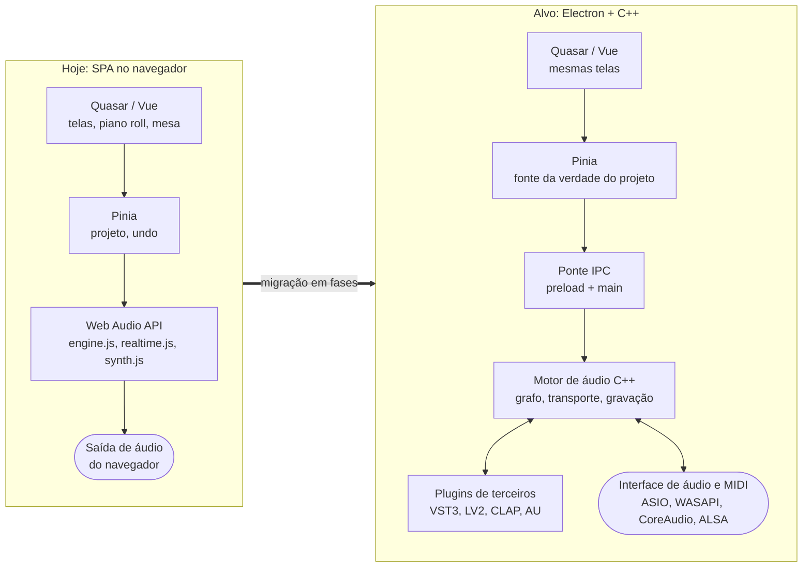
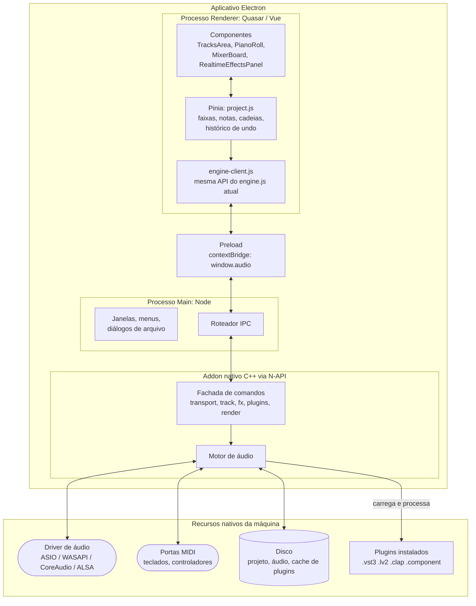
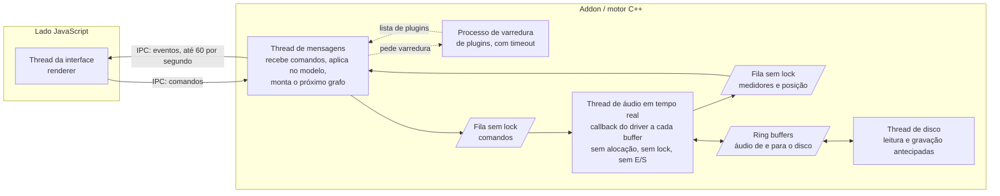
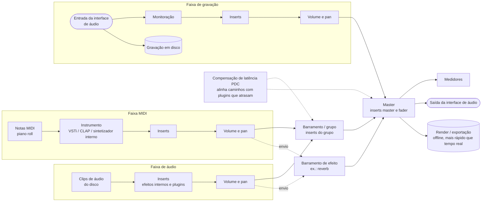
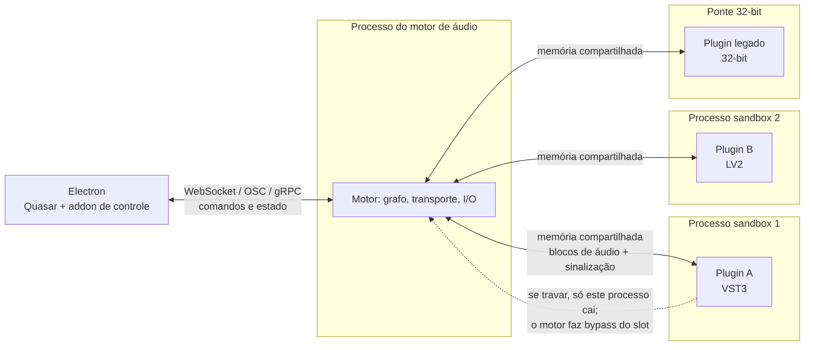
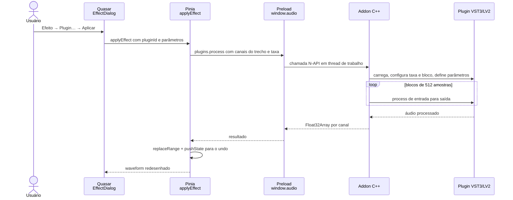
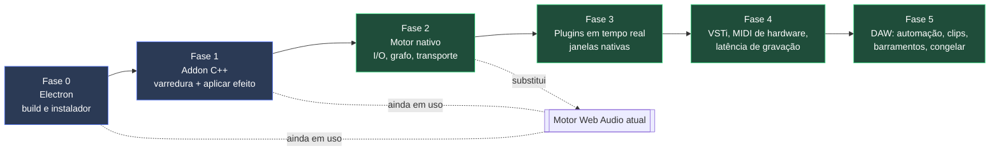
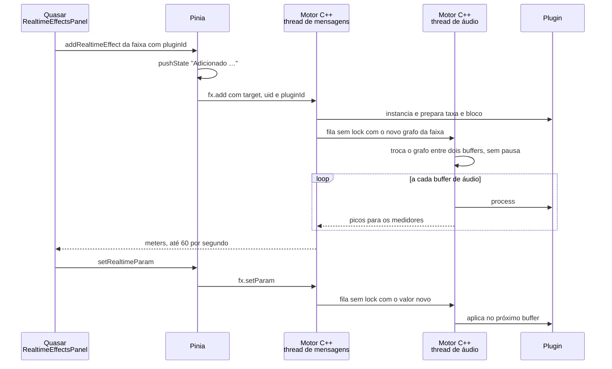
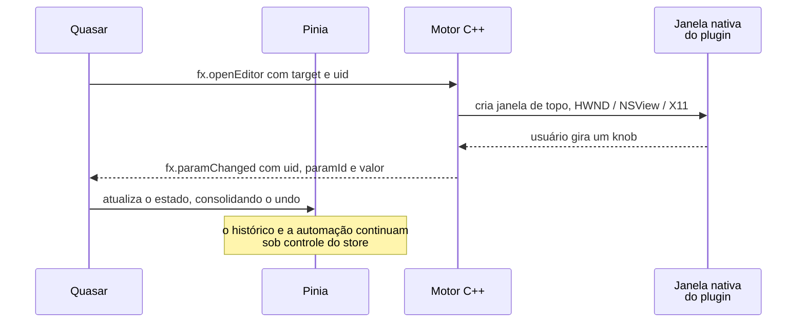

# Plugins de áudio (VST, LV2, LADSPA, CLAP) e o caminho para uma DAW nativa

Este documento registra a análise sobre integrar plugins de terceiros e o plano
para transformar o Raven Audio Editor, hoje uma SPA Quasar, num aplicativo
**Electron + C++** com acesso nativo à máquina e, mais adiante, numa DAW.

- Situação atual: SPA no navegador, com motor de áudio em Web Audio API.
- Objetivo: app desktop (Electron) com motor de áudio nativo em C++, hospedagem
  de plugins de terceiros, baixa latência e acesso direto a dispositivos de áudio e MIDI.

> Os diagramas usam **Mermaid**. Eles aparecem desenhados no GitHub e no GitLab,
> e no VS Code com a extensão *Markdown Preview Mermaid Support*.

### Visão geral: de onde saímos e aonde queremos chegar



---

## 1. Por que plugins não funcionam no navegador

VST2, VST3, LV2, LADSPA e CLAP são **bibliotecas nativas compiladas**:

| Formato | Arquivo | Observação |
|---|---|---|
| VST2 | `.dll` (Win), `.vst` (macOS), `.so` (Linux) | SDK descontinuado, ver seção 6 |
| VST3 | pacote `.vst3` | SDK gratuito da Steinberg |
| LV2 | pasta `.lv2` (`.so`/`.dll` + metadados `.ttl`) | Padrão aberto |
| LADSPA | `.so`/`.dll` | Antecessor do LV2, sem interface gráfica própria. **Não existe "LV1"**: o formato anterior ao LV2 é o LADSPA |
| CLAP | `.clap` | Padrão aberto e moderno, com adoção crescente |
| AU | `.component` | Só macOS |

O programa que hospeda o plugin carrega a biblioteca **no próprio processo** e
chama as funções de processamento no **thread de áudio em tempo real**. O
navegador não permite carregar código nativo. Mesmo o `AudioWorklet` só executa
JavaScript ou WebAssembly. Por isso, numa SPA, a integração com esses
plugins é impossível.

O Audacity faz a hospedagem em código nativo, e o clone em `refs/audacity`
mostra onde:

| Formato | Biblioteca de hospedagem | Interface/efeito |
|---|---|---|
| VST2 | `libraries/lib-vst` | `src/effects/VST` |
| VST3 | `libraries/lib-vst3` | `src/effects/VST3` |
| LV2 | `libraries/lib-lv2` | `src/effects/lv2` |
| LADSPA | `libraries/lib-ladspa` | `src/effects/ladspa` |
| Audio Unit | `libraries/lib-audio-unit` | `src/effects/audiounits` |

Esses módulos são boas referências de implementação (descoberta de plugins,
carregamento, mapeamento de parâmetros, presets, tela genérica).

---

## 2. Opções de arquitetura

### Opção A: Electron + motor de áudio nativo em C++ (recomendada para a DAW)

#### Diagrama de componentes



#### Threads dentro do motor C++

O ponto mais importante da arquitetura: o **thread de áudio** nunca espera
ninguém. A comunicação com ele é só por filas sem lock.



#### Fluxo de sinal da DAW (grafo de áudio)

É a mesma topologia que o `engine.js` já monta em Web Audio (faixa → efeitos da
faixa → pan/volume → master), acrescida de barramentos, envios e instrumentos virtuais.



- O áudio **não passa pela interface**. O Quasar envia comandos (tocar, mover
  fader, adicionar efeito) e recebe estado (posição, medidores, latência).
- Ir e voltar entre Web Audio e o código nativo por IPC adiciona latência e
  causa cortes. Por isso **o motor inteiro precisa ir para o lado nativo**.
- Bibliotecas candidatas:
  - **JUCE**: I/O de áudio e MIDI multiplataforma, hospedagem de VST3, AU e LV2
    (desde o JUCE 7), grafo de processamento (`AudioProcessorGraph`). Licença
    comercial ou AGPLv3.
  - **Tracktion Engine**: motor de DAW completo construído sobre o JUCE
    (edições, clips, automação, plugins, render).
  - **Carla**: hospeda LADSPA, DSSI, LV2, VST2, VST3, CLAP e SF2/SFZ, e pode rodar
    sem interface própria, como biblioteca ou processo. Licença GPLv2+.
  - Alternativa mais "mão na massa": **RtAudio/PortAudio** + **VST3 SDK** + **lilv**
    (LV2) + **CLAP SDK**, com grafo próprio.

### Opção B: processo nativo separado, controlado pela interface

- Um executável à parte (por exemplo Carla em modo sem interface, ou um app
  JUCE próprio) faz o áudio e os plugins. O Quasar conversa com ele por
  WebSocket, OSC ou gRPC.
- Vantagens:
  - **isolamento**: um plugin que trava não derruba a interface;
  - permite **sandbox de plugins** (um processo por plugin, como o Bitwig faz);
  - funciona até com a interface no navegador.
- Desvantagens: mais coordenação entre processos e mais um executável para distribuir.
- Dá para combinar com a Opção A: o addon só inicia e controla o processo de áudio.



### Opção C: só aplicar o efeito, sem tempo real (fase intermediária)

- No Electron, um addon nativo recebe um trecho de áudio (`Float32Array`),
  passa pelo plugin e devolve o resultado, como o "Efeito → Aplicar" do Audacity.
- Mantém o motor Web Audio atual. Não há prévia ao vivo nem plugin na mesa de
  som durante a reprodução.
- É o menor passo para validar a hospedagem de plugins sem reescrever o motor.



### Opção D: continuar 100% web (Web Audio Modules)

- **WAM 2.0** é o padrão de plugins para o navegador, com plugins em
  WebAssembly (gerados com iPlug2, Faust, ports do JUCE).
- Não carrega os plugins nativos já instalados na máquina. Só serve se a
  aplicação precisar continuar rodando no navegador.

---

## 3. Recomendação e roteiro

Para o objetivo declarado (app desktop, acesso nativo e uma DAW no futuro), a
recomendação é a **Opção A**, chegando nela em fases.

| Fase | Entrega | Motor de áudio | Risco |
|---|---|---|---|
| 0 | Projeto em modo Electron (`quasar mode add electron`), build e instalador | Web Audio (atual) | Baixo |
| 1 | Addon C++ (N-API) que **lista plugins** VST3/LV2/CLAP instalados e **aplica efeito em trecho** (Opção C) | Web Audio + addon só para aplicar efeito | Baixo/médio |
| 2 | **Motor nativo** de reprodução e mixagem (I/O nativo, grafo, transporte). O Web Audio sai | Nativo | Alto |
| 3 | Plugins **em tempo real** nas cadeias de faixa e master, mais as janelas nativas dos plugins | Nativo | Médio |
| 4 | Instrumentos virtuais (VSTi) nas faixas MIDI, MIDI I/O de hardware, gravação com compensação de latência | Nativo | Médio |
| 5 | Recursos de DAW: automação, clips, envios/barramentos, congelar faixa, render em segundo plano | Nativo | Médio |



Azul: fases que ainda usam o motor Web Audio. Verde: fases com motor nativo.

### 3.1 O que muda no código atual

| Hoje (SPA) | Depois (Electron + C++) |
|---|---|
| `src/audio/engine.js` (grafo Web Audio, `render` offline, agendador MIDI, gravação) | Vira um **cliente** do motor nativo: mesma API (`play`, `stop`, `updateMix`, `render`, `startCapture`), mas implementada com chamadas IPC |
| `src/audio/realtime.js` (efeitos como nós Web Audio) | Efeitos internos migram para C++. O catálogo passa a vir do motor (internos + plugins encontrados na varredura) |
| `src/audio/synth.js` | Sai de cena ou vira o instrumento padrão no motor nativo. Faixas MIDI passam a aceitar VSTi |
| `src/audio/effects.js`, `dsp.js` | Podem ficar em JS no começo (efeitos destrutivos). Depois migram para C++ por desempenho |
| `src/stores/project.js` | **Continua sendo a fonte da verdade** do projeto (faixas, notas, cadeias, undo). Envia os comandos ao motor (ver `syncPlayback`, `addRealtimeEffect`) |
| Áudio em `Float32Array` na memória do renderer | O áudio passa a viver no motor, com paginação em disco para projetos longos (como o `.aup3`/SQLite do Audacity). O renderer recebe só resumos para desenhar o waveform (`summary.js` vira um serviço do motor) |
| `.ravenproj` (JSON + Float32) | Formato de projeto com referência a arquivos de áudio e **estado dos plugins** (chunk do VST3, estado do LV2) |

A separação que já existe ajuda nessa migração: as telas (`components/`)
não falam com o Web Audio diretamente, só com o store e com `engine`.

### 3.2 Contrato de IPC sugerido (rascunho)

Mensagens da interface para o motor (comandos):

```
transport.play { from, to, loop }      transport.stop
track.setGain { id, db }               track.setPan { id, pan }
fx.add { target, pluginId }            fx.remove { target, uid }
fx.setParam { target, uid, paramId, value }
fx.openEditor { target, uid }          // abre a janela nativa do plugin
plugins.scan { paths }                 render.offline { range, tracks } -> arquivo
```

Mensagens do motor para a interface (eventos, 30 a 60 por segundo no máximo):

```
transport.position { t }               meters { trackId: [l, r], master: [l, r] }
plugins.scanProgress / plugins.list    fx.paramChanged { ... }   // mexeu na janela do plugin
engine.xrun / engine.latency
```

Exemplo: adicionar um plugin à faixa e mexer em parâmetros enquanto toca.



Exemplo: abrir a janela nativa do plugin e manter a interface sincronizada.



Regras importantes:
- **Nunca** bloquear o thread de áudio esperando a interface. A comunicação
  com o thread de áudio usa filas sem lock.
- Medidores e posição são enviados com taxa limitada, nunca a cada buffer.

---

## 4. Telas (GUI) dos plugins

- Cada plugin desenha a própria janela nativa (HWND no Windows, NSView no
  macOS, X11 no Linux). **Não é viável embutir essa janela dentro da página
  Electron.**
- Abordagens:
  1. Abrir a janela do plugin como **janela nativa separada**, criada pelo motor.
     É o padrão das DAWs.
  2. **Tela genérica** gerada a partir dos parâmetros do plugin (como a opção
     "Generic UI" do Audacity e o nosso `RealtimeEffectsPanel.vue`). Útil para
     plugins sem tela e para automação.
- Os parâmetros alterados na janela nativa precisam voltar para o store da
  interface (evento `fx.paramChanged`), para manter undo e automação.

---

## 5. Plataforma, desempenho e estabilidade

- **Arquitetura e SO:** o plugin precisa bater com o app (Windows x64, macOS
  arm64/x64 universal, Linux x64). Plugins 32-bit exigem uma ponte (processo
  separado).
- **Drivers no Windows:** ASIO para baixa latência (o SDK da Steinberg tem
  licença própria), WASAPI exclusivo como alternativa.
- **Thread de áudio:** sem alocação de memória, sem lock e sem E/S de disco no
  callback. O tamanho de buffer é configurável (64 a 1024 amostras).
- **Compensação de latência (PDC):** plugins informam latência; o motor
  alinha as faixas.
- **Plugins que travam:** considere hospedagem fora do processo (Opção B) para
  isolar falhas, ou ao menos tratar exceções e marcar o plugin como problemático
  (o Audacity tem um diálogo de plugins incompatíveis: `src/IncompatiblePluginsDialog.cpp`).
- **Varredura de plugins:** fazer em processo separado, com timeout e cache,
  porque alguns plugins travam ao carregar.
- **Assinatura e notarização:** instaladores no macOS precisam de notarização;
  no Windows, assinatura de código evita alertas do SmartScreen.

---

## 6. Licenças

| Item | Licença / situação |
|---|---|
| **VST2** | A Steinberg **encerrou o SDK em 2018** e não concede mais licença nova. Hospedar VST2 só é seguro para quem já tinha acordo assinado. Cabeçalhos reimplementados ("vestige", usado por LMMS e outros) são juridicamente arriscados. **Recomendação: não suportar VST2** ou tratar como opcional, após análise jurídica |
| **VST3 SDK** | Duas opções: GPLv3 ou licença proprietária gratuita da Steinberg (exige aceitar os termos e usar o logo conforme as regras) |
| **ASIO SDK** | Licença própria da Steinberg (gratuita, com termos) |
| **LV2 / lilv** | ISC (permissiva) |
| **LADSPA** | LGPL (cabeçalho) |
| **CLAP** | MIT |
| **JUCE** | Comercial ou AGPLv3. Um produto fechado exige licença comercial |
| **Tracktion Engine** | Comercial ou GPLv3 |
| **Carla** | GPLv2+. Usar como biblioteca obriga o app a ser compatível com a GPL; como processo separado, a análise é diferente |
| **Electron** | MIT |

Antes de escolher a pilha, decida o modelo de licença do produto (código
aberto ou fechado). Isso elimina ou exige licenças comerciais (JUCE, Tracktion).

---

## 7. Primeiros passos práticos (Fase 0 e 1)

1. `npx quasar mode add electron`, e depois testar `quasar dev -m electron` e
   `quasar build -m electron`.
2. Criar o addon nativo com **node-addon-api** + **cmake-js** (ou `node-gyp`), e
   compilar contra a versão de Node do Electron (`@electron/rebuild`).
3. Expor ao renderer só por `contextBridge` no preload (sem `nodeIntegration`),
   com uma API mínima: `plugins.scan()`, `plugins.process(pluginId, params, channels, rate)`.
4. Implementar a varredura de VST3 (pastas padrão: `C:\Program Files\Common Files\VST3`,
   `/Library/Audio/Plug-Ins/VST3`, `~/.vst3`) e LV2 (`LV2_PATH`).
5. No editor atual, criar um efeito "Plugin…" no menu Efeito que chama
   `plugins.process` sobre a seleção, aproveitando `store.applyEffect`.
6. Validar com plugins gratuitos: por exemplo os do pacote **LSP** (LV2/VST3/CLAP),
   **Airwindows** e **Surge XT** (instrumento VST3/CLAP).

---

## 8. Referências

- VST3 SDK: https://github.com/steinbergmedia/vst3sdk
- LV2: https://lv2plug.in · lilv: https://drobilla.net/software/lilv
- CLAP: https://github.com/free-audio/clap
- JUCE: https://juce.com · Tracktion Engine: https://github.com/Tracktion/tracktion_engine
- Carla: https://github.com/falkTX/Carla
- RtAudio: https://github.com/thestk/rtaudio · PortAudio: https://www.portaudio.com
- Web Audio Modules 2.0: https://github.com/webaudiomodules
- Quasar + Electron: https://quasar.dev/quasar-cli-vite/developing-electron-apps/introduction
- node-addon-api: https://github.com/nodejs/node-addon-api
- Código de hospedagem no Audacity 3.7.9: `refs/audacity/libraries/lib-vst3`, `lib-lv2`, `lib-ladspa`
